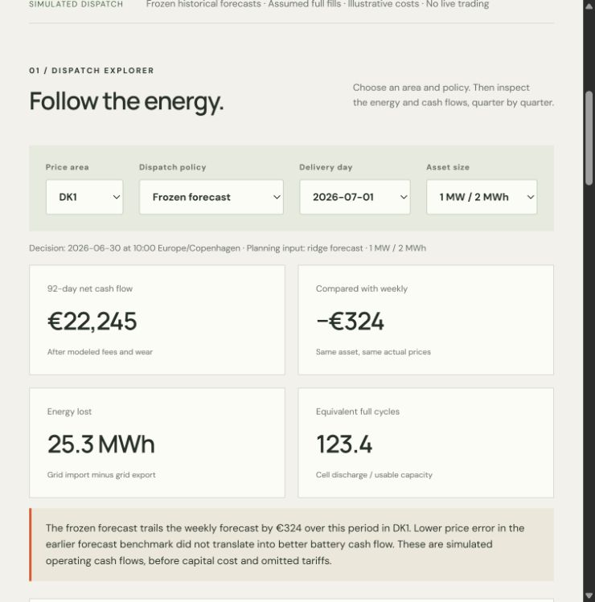

# Cellar — Danish Battery Dispatch Lab

[Interactive preview](https://ehsan-ch.github.io/danish-battery-dispatch-lab/) · [Frozen protocol](docs/PROTOCOL.md) · [Results](docs/RESULTS.md) · [Data provenance](docs/DATA.md)

**Does a better price forecast produce a better battery schedule?** Cellar turns frozen DK1/DK2 price forecasts into physically constrained charge/discharge schedules, then reconciles every quarter-hour against actual prices. In this replay, the weekly forecast beats the previously selected models on battery cash flow in both areas.

This is a research portfolio project, not a trading service or an investment-return estimate. The core work is dispatch optimization, energy accounting and decision-value evaluation. Forecasts are reused transparently from [Nordcast](https://github.com/Ehsan-Ch/danish-power-forecast-lab).



## The experiment

- 1 MW / 2 MWh hypothetical battery, 95% charge and discharge efficiency.
- Exactly 50% charge at both daily boundaries; no free energy reset.
- Mixed-integer optimization prohibits simultaneous charging and discharging, including at negative prices.
- €2/MWh grid throughput fee and €8/MWh cell-discharge wear proxy.
- Fixed schedules at 10:00 Copenhagen time on D−1; settlement at actual day-ahead prices, assuming full fills.
- 92 delivery days per area: 1 July–30 September 2026. Frozen forecast, weekly forecast, idle and perfect-price hindsight policies.

| Net operating cash flow, 92 days | DK1 | DK2 |
|---|---:|---:|
| Frozen forecast | €22,245 | €20,871 |
| Weekly forecast | €22,569 | €22,928 |
| Idle | €0 | €0 |
| Perfect-price hindsight | €28,226 | €27,871 |

The frozen forecast trails weekly by **€324 in DK1 and €2,058 in DK2**. All 552 optimization runs reached status 0; maximum reported relative solver gap was below 4e−16. Capital cost, financing, grid tariffs, taxes, imbalance costs and market impact are excluded. Hindsight is unavailable at the modeled decision time.

## Run locally

Requires Python 3.11 or 3.12. From the repository root:

```sh
python -m venv .venv
# Windows: .venv\Scripts\activate
# macOS/Linux: source .venv/bin/activate
python -m pip install -e .
python -m cellar.cli serve --port 8792
```

Open http://127.0.0.1:8792/. The static preview needs no API key, backend or model download. Opening `index.html` as a file will not load its JSON in browsers that block local file requests. GitHub Pages serves the same files publicly.

Reproduce all 552 daily optimization runs from the included hash-pinned forecast archive:

```sh
python -m cellar.cli replay --output reports/custom
python -m unittest discover -s tests -v
node --test tests/core.test.mjs
```

The replay stops on any non-optimal solve or failed physical constraint. On the development machine the full replay took a few minutes. Solver version/platform changes can choose different schedules when objectives tie; compare physical feasibility and objectives, not just exact schedule bytes. UI values use seven-decimal schedule exports, while `reports/dispatch.csv.gz` retains full precision.

## Layout

| Location | Purpose |
|---|---|
| `cellar/battery.py` | MILP formulation, independent feasibility checks and settlement |
| `cellar/source.py` | Pinned input, completeness checks, UTC and DST handling |
| `cellar/pipeline.py` | Replay, daily results and interval journal |
| `data/forecasts.csv.gz` | Exact Nordcast archive, SHA256 verified on load |
| `reports/results.json` | Interactive report, solver records and daily schedules |
| `reports/daily.csv` | 736 policy-day records |
| `reports/dispatch.csv.gz` | 70,656 interval records, full precision |
| `tests/` | 20 Python tests plus 6 JavaScript tests |

CI tests Python 3.11/3.12 and Node 22. Tests include analytical optima, negative-price mode constraints, physical/accounting reconciliation, hash integrity, original forecast preservation, solver failure handling, DST, UI scaling and CSV exports.

## Interpretation

Battery parameters and policies were frozen before calculating dispatch results, but the source evaluation sample was already examined in prior projects. This is **not an independent new out-of-sample forecast test**. Upstream forecasts use delayed historical prices; the source archive may contain revisions. Model choice remains ridge for DK1 and boosted median for DK2, as selected in Nordcast's June validation. No selection is changed after seeing dispatch cash flow.

The early commitment is hypothetical. A scheduler acting after day-ahead prices are known could optimize those prices directly. The wear allowance is illustrative rather than a validated aging model. Real implementation needs hardware constraints, market access and the omitted costs. See [the full protocol](docs/PROTOCOL.md).

Code: MIT. Source-derived data/results: CC BY 4.0, attribution to Energinet and the pinned Nordcast artifact; see [DATA.md](docs/DATA.md).
